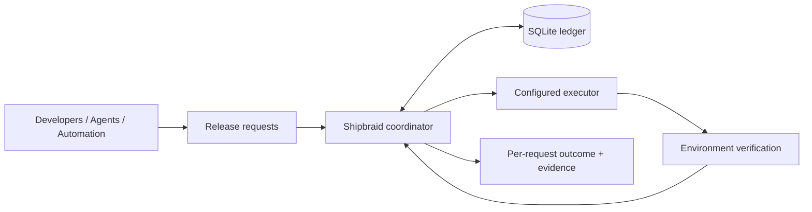

<p align="center">
  
</p>
<h1 align="center">Shipbraid</h1>
<p align="center"><strong>Shared runs. Safe handoffs. Verified releases.</strong></p>
<p align="center">A durable release-request coordinator, built in Rust.</p>
<p align="center">English · <a href="README.zh-CN.md">简体中文</a></p>

Shipbraid coordinates release requests from developers, agents, and automation. Compatible requests share an execution; urgent requests can replace interruptible work when safe; every request keeps its own identity until matching environment evidence confirms delivery.

**Status: early development.** The current source adds a foreground local CLI for one project; it has not shipped in a GitHub Release yet. Local simulation and configurable external hooks are implemented. Safe preemption currently works with the simulated executor; external hooks are non-preemptible, and production lanes are disabled by default.

The CLI and service executable is `shipbraid`; environment variables use `SHIPBRAID_`, and new installations use `shipbraid.service`. See the [rename and upgrade notes](docs/naming.md) before upgrading an existing installation.


Release requests, execution links, and environment verification receipts in the read-only dashboard.

## Why Shipbraid?

Several callers may ask to release the same version. A newer urgent release may cover work already queued. Canceling a CI run can leave callers wondering whether their change ever reached the environment.

Shipbraid gives each caller a persistent request and tracks its outcome separately from the execution doing the work:

- **Share work.** Compatible requests wait on the same run while retaining separate deadlines, permissions, and outcomes.
- **Hand off safely.** With a capable executor, urgent work can replace interruptible normal work after the old execution is confirmed stopped.
- **Verify delivery.** Requests become `satisfied` only after matching release evidence is accepted. A canceled run or green CI check is insufficient.
- **Recover with ownership intact.** Durable commands and audit events survive restarts. An uncertain execution retains its lane until independently reconciled.

An execution can be `superseded` while its requests continue waiting for a successor. Replacing work does not discard the original intent.

## How it fits



A **request** is an immutable release intent. A **run** is one execution attempt. A **lane** is a shared deployment boundary, with at most one active run. A **receipt** records the observed revision, components, configuration, and verification result.

Coverage checks repository, lane, components, configuration, authorization, and revision policy. The default is an exact revision match. Explicitly enabled `descendant` coverage also checks Git ancestry; ancestry proves history, and cannot prove that a feature has not been reverted.

Shipbraid coordinates release requests while each project keeps its own build and deployment tools. A single operator can run one project's coordinator in the foreground against a private local ledger. Use a shared server for multiple projects, concurrent Agent/CI submissions, background observation, or a Dashboard.

## Quick start: use a binary

Download a published Linux x86_64 GNU bundle and its `.sha256` file from [GitHub Releases](https://github.com/aak1247/shipbraid/releases), verify, and unpack. The bundle includes the CLI/server, prebuilt dashboard, adapters, and installer; users need neither Rust nor Node.js. Use the version shown on the Releases page; v0.3.1 is the current published binary bundle.

```bash
# Use the version you downloaded; 0.3.1 is shown here.
sha256sum --check shipbraid-0.3.1-x86_64-unknown-linux-gnu.tar.gz.sha256
tar -xzf shipbraid-0.3.1-x86_64-unknown-linux-gnu.tar.gz
cd shipbraid-0.3.1-x86_64-unknown-linux-gnu
export SHIPBRAID_BUNDLE="$PWD"
export PATH="$SHIPBRAID_BUNDLE/bin:$PATH"
shipbraid --version
```

Source version `0.3.2-dev` adds `shipbraid run --config PATH` and a local-default standalone installer. The published v0.3.1 bundle does not include `run`, local-mode configuration, or installer `--mode`; use a later feature-enabled bundle for the [single-project local CLI workflow](docs/local-cli.md). The local CLI needs Git to validate the trusted mirror, but no HTTP server or client token. A real project's current bundled adapter still needs Python **3.11+**, systemd **249+** user manager, and cgroup v2; this is not a zero-dependency deployment runtime.

The [synthetic binary simulation](docs/distribution.md#本地模拟) remains available for the published v0.3.1 server workflow and does not deploy an application. Source version 0.3.2-dev also provides a read-only `shipbraid doctor --config PATH` prerequisite check; see the [diagnostics guide](docs/diagnostics.md). The published v0.3.1 bundle does not include `doctor` either.

### Shared server workflow

For a team server, developers need the service URL, personal token file, and registered target. This HTTP workflow is supported by the published v0.3.1 binary:

```bash
export SHIPBRAID_URL="http://127.0.0.1:8787"
export SHIPBRAID_TOKEN_FILE="$HOME/.config/shipbraid/my-project.token"
shipbraid --json system
shipbraid --json list lane
shipbraid submit \
  --project my-project --environment dev \
  --revision <full-synced-SHA> --components app \
  --idempotency-key <stable-release-intent-key>
shipbraid wait REQUEST_ID --timeout-seconds 600
shipbraid inspect request REQUEST_ID
```

Replace the example target, components, and credential path with your project's values; use the id returned by submit for `REQUEST_ID`. Retry the same intent with the same idempotency key and body. Reusing a key with a different body returns a conflict. Coverage defaults to exact; descendant mode requires explicit lane opt-in.

A local `wait` timeout or disconnect does not withdraw the request. Exit codes: `0` satisfied, `2` needs attention, `3` expired, `4` withdrawn, `124` local timeout, `1` command/configuration error.

The same service serves the dashboard at `http://127.0.0.1:8787` by default. Enter your token, which stays in page memory. No separate frontend dev server is needed. For remote access, use the team's controlled HTTPS endpoint or SSH forwarding.

## For agents

Use [the Agent guide](docs/agents.md) for mode selection, project prerequisites, target discovery, identity setup, the CLI reference, task recovery, structured errors, and collaboration permissions. Local mode has one same-user trust boundary and one project per ledger. A shared server fixes the tenant to `local`; maintainers register repositories and lanes, then record the team's service URL, lane, components, and publishing steps in the project's `AGENTS.md` using the [project integration guide](docs/project-integration.md).

## Connect an executor

External integrations use administrator-configured **commands, scripts, or webhooks** with a versioned JSON protocol:

| Operation | Responsibility |
| --- | --- |
| `dispatch` | Hand off work and return a stable execution identity. |
| `observe` | Independently query the execution's actual state. |
| `verify` | Inspect the target environment and return matching release evidence. |

Long-running work belongs in an independent supervisor. A successful dispatch response is not release acceptance. Hooks v1 requires `allow_preemption = false`; it has no cancel hook.

See the [executor protocol](docs/hooks.md) and [project integration guide](docs/project-integration.md) for setup. Shipbraid does not depend on a client project's database, runtime, or business entities.

## Operating model and current limits

- **One instance, local storage.** SQLite uses WAL, FULL synchronization, and an exclusive process lock. Use a local persistent volume; use SQLite's online backup API for live backups.
- **Explicit access boundaries.** Operators configure repositories, lanes, components, executors, and (for server mode) token capabilities. Clients cannot submit arbitrary commands or repository URLs. The server's default listener is loopback; use a controlled HTTPS entry point for remote access.
- **Evidence before ownership transfer.** A cancel acknowledgment, timeout, or lost heartbeat does not prove that an execution stopped. Unknown state blocks the lane. Deployment and verification phases are non-preemptible.
- **At-least-once delivery.** Commands and events may be delivered repeatedly; adapters must handle duplicates and ambiguous dispatch. External effects are not guaranteed to occur exactly once.

Current-environment evidence reuse, configurable automatic retry budgets, fairness policy, the full crash/fault matrix, and exported phase metrics remain unfinished. The recorded **50 requests/s for 60s, p95 < 250ms** performance target has **not passed**. See the [acceptance record](docs/acceptance/m1.md) and [execution plan](docs/execution-plan.md) for measured results and open work.

## Development

```bash
cargo fmt --all --check
cargo clippy --locked --all-targets -- -D warnings
cargo test --locked
cargo build --locked
python3 scripts/acceptance.py
python3 scripts/acceptance-hooks.py
python3 scripts/acceptance-agents.py
python3 scripts/test_package_release.py
python3 deploy/test_install_standalone.py
python3 integration/local/test_adapter.py
python3 integration/github/test_receiver.py

pnpm --dir web install --frozen-lockfile
pnpm --dir web typecheck
pnpm --dir web test
pnpm --dir web build
```

The acceptance scripts use temporary repositories, databases, and tokens. Hook protocol fixtures are synthetic; they do not deploy a real application.

Contributions are welcome. Start with the [design](docs/design.md), [execution plan](docs/execution-plan.md), and [agent guide](AGENTS.md). Keep request outcomes separate from execution states, and include evidence for any newly claimed capability. Never commit tokens, private keys, full databases, or deployment logs containing secrets.

## Documentation

- [Binary installation, project scripts, webhooks, and upgrades](docs/distribution.md)
- [Single-project local CLI](docs/local-cli.md)
- [Agent workflow and collaboration](docs/agents.md)
- [Project integration and project AGENTS.md template](docs/project-integration.md)
- [HTTP API and CLI contract](docs/api.md)
- [Executor hooks and installation](docs/hooks.md)
- [Architecture and domain model](docs/design.md)
- [Implementation contract](docs/implementation-contract.md)
- [Acceptance results and known gaps](docs/acceptance/m1.md)
- [Logo and brand assets](docs/assets/README.md)

## License

[MIT](LICENSE).
