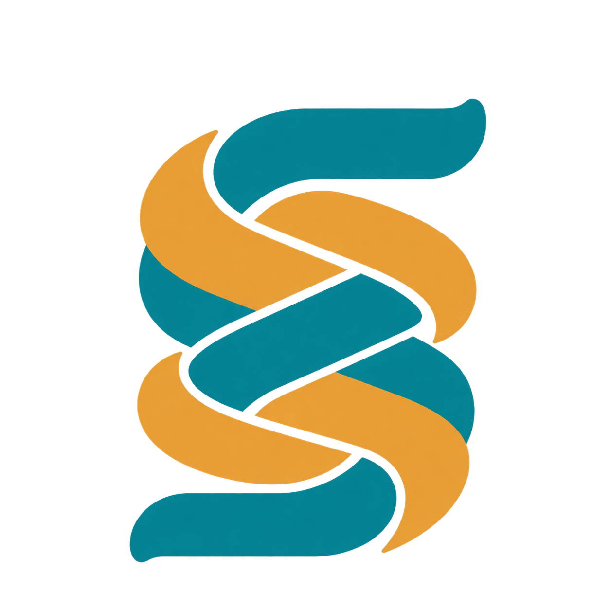
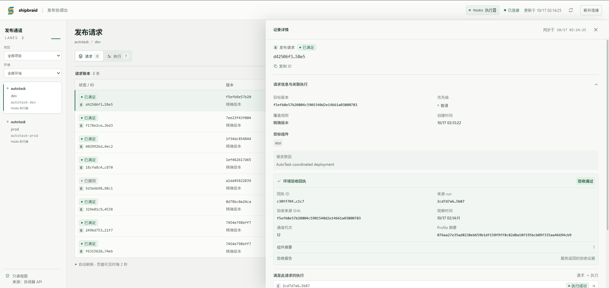
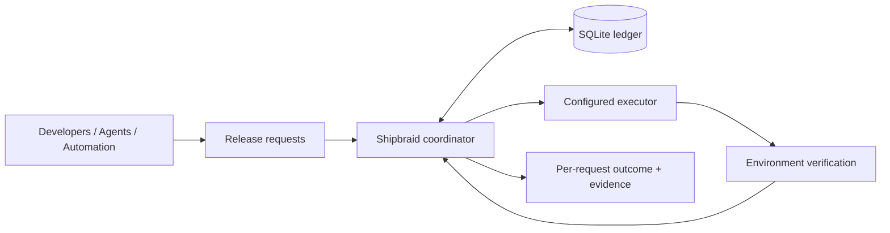

<p align="center">
  
</p>
<h1 align="center">Shipbraid</h1>
<p align="center"><strong>Shared runs. Safe handoffs. Verified releases.</strong></p>
<p align="center">A durable release-request coordinator, built in Rust.</p>
<p align="center">English · <a href="README.zh-CN.md">简体中文</a></p>

Shipbraid coordinates release requests from developers, agents, and automation. Compatible requests share an execution; urgent requests can replace interruptible work when safe; every request keeps its own identity until matching environment evidence confirms delivery.

**Status: early development.** Local simulation and configurable external hooks are implemented. The first real integration has been verified against an AutoTask local development environment. Safe preemption currently works with the simulated executor; external hooks are non-preemptible, and production is disabled in the supplied integration.

The Cargo package and executable are `shipbraid`; environment variables use `SHIPBRAID_`, and new installations use `shipbraid.service`. See the [rename and upgrade notes](docs/naming.md) before upgrading an existing installation.



Release requests, execution links, and environment verification receipts in the read-only dashboard.

## Why Shipbraid?

Several callers may ask to release the same version. A newer urgent release may cover work already queued. Canceling a CI run can leave callers wondering whether their change ever reached the environment.

Shipbraid gives each caller a persistent request and tracks its outcome separately from the execution doing the work:

- **Share work.** Compatible requests wait on the same run while retaining separate deadlines, permissions, and outcomes.
- **Hand off safely.** With a capable executor, urgent work can replace interruptible normal work after the old execution is confirmed stopped.
- **Verify delivery.** Requests become `satisfied` only after matching release evidence is accepted. A canceled run or green CI check is insufficient.
- **Recover with ownership intact.** Durable commands and audit events survive restarts. An uncertain execution retains its lane until independently reconciled.

An execution can be `superseded` while its requests continue waiting for a successor. Replacing work does not discard the original intent.

## How it fits



A **request** is an immutable release intent. A **run** is one execution attempt. A **lane** is a shared deployment boundary, with at most one active run. A **receipt** records the observed revision, components, configuration, and verification result.

Coverage checks repository, lane, components, configuration, authorization, and revision policy. The default is an exact revision match. Explicitly enabled `descendant` coverage also checks Git ancestry; ancestry proves history, and cannot prove that a feature has not been reverted.

Shipbraid is independent of AutoTask and uses your configured build and deployment tools. Its runtime is one Rust service with a local SQLite database, an HTTP API, a CLI, and a read-only React dashboard.

## Quick start: local simulation

Requires Rust **1.94+**, Git, and OpenSSL for the token-generation commands below. The optional dashboard requires Node.js **24** and pnpm **11.24.0**. Run commands from the repository root.

### 1. Start the coordinator

```bash
git clone https://github.com/aak1247/shipbraid.git shipbraid
cd shipbraid
cargo build --locked

mkdir -p data
git clone --mirror . data/source.git
# The sample config trusts main, even when the checkout uses a different branch.
git --git-dir=data/source.git update-ref refs/heads/main "$(git rev-parse HEAD)"

export SHIPBRAID_TOKEN="$(openssl rand -hex 32)"
export SHIPBRAID_EXECUTOR_TOKEN="$(openssl rand -hex 32)"
cargo run --locked -- serve --config examples/local.toml
```

The API listens on `http://127.0.0.1:8787`. This configuration uses **ScriptedExecutor**: it simulates builds, deployment phases, and verification without deploying an application. The mirror is a fixed local snapshot; it is not automatically fetched or updated.

### 2. Submit a request

In a second terminal, enter the repository and set `SHIPBRAID_TOKEN` to the same operator token used above. Keep tokens private; the CLI also supports `--token-file`.

```bash
REVISION=$(git rev-parse HEAD)
cargo run --locked -- submit \
  --lane demo-test \
  --revision "$REVISION" \
  --components app \
  --idempotency-key my-first-release

# Replace REQUEST_ID with the id returned by submit.
cargo run --locked -- wait REQUEST_ID --timeout-seconds 120
cargo run --locked -- list request --lane demo-test
```

Retry the same intent with the same idempotency key and body. Reusing a key with different content returns a conflict. Separate requests for a compatible target can share an active run.

You can also select a lane with `--project demo --environment test`. Urgent submission uses `--priority urgent` and requires an authorized token. `--coverage descendant` requires explicit lane opt-in.

`wait` timing out or disconnecting leaves the server request active. Exit codes: `0` satisfied, `2` needs attention, `3` expired, `4` withdrawn, `124` local timeout, `1` command/configuration error.

### 3. Open the dashboard

```bash
pnpm --dir web install --frozen-lockfile
pnpm --dir web dev
```

Open `http://127.0.0.1:5187` and enter the operator token. Vite proxies API requests to the coordinator. The token stays in page memory.

The read-only dashboard shows lanes, requests, runs, replacement relationships, environment filters, audit timelines, bounded logs, and verification receipts. Submit requests and perform administrative operations through the API or CLI.

## For agents

Use [the Agent guide](docs/agents.md) for identity setup, target discovery, task recovery, structured CLI errors, and collaboration permissions. The server currently fixes the tenant to `local`.

## Connect an executor

External integrations use administrator-configured **commands, scripts, or webhooks** with a versioned JSON protocol:

| Operation | Responsibility |
| --- | --- |
| `dispatch` | Hand off work and return a stable execution identity. |
| `observe` | Independently query the execution's actual state. |
| `verify` | Inspect the target environment and return matching release evidence. |

Long-running work belongs in an independent supervisor. A successful dispatch response is not release acceptance. Hooks v1 requires `allow_preemption = false`; it has no cancel hook.

See the [executor protocol and installation guide](docs/hooks.md) for configuration and the [AutoTask development integration](docs/features/iter-20261016-executor-integration/verification.md) for the first real deployment's evidence. The generic coordinator has no dependency on AutoTask's database, runtime, or business entities.

## Operating model and current limits

- **One instance, local storage.** SQLite uses WAL, FULL synchronization, and an exclusive process lock. Use a local persistent volume; use SQLite's online backup API for live backups.
- **Explicit access boundaries.** Operators configure repositories, lanes, components, executors, and token capabilities. Clients cannot submit arbitrary commands or repository URLs. The default listener is loopback; use a controlled HTTPS entry point for remote access.
- **Evidence before ownership transfer.** A cancel acknowledgment, timeout, or lost heartbeat does not prove that an execution stopped. Unknown state blocks the lane. Deployment and verification phases are non-preemptible.
- **At-least-once delivery.** Commands and events may be delivered repeatedly; adapters must handle duplicates and ambiguous dispatch. External effects are not guaranteed to occur exactly once.

Current-environment evidence reuse, configurable automatic retry budgets, fairness policy, the full crash/fault matrix, and exported phase metrics remain unfinished. The recorded **50 requests/s for 60s, p95 < 250ms** performance target has **not passed**. See the [acceptance record](docs/acceptance/m1.md) and [execution plan](docs/execution-plan.md) for measured results and open work.

## Development

```bash
cargo fmt --all --check
cargo clippy --locked --all-targets -- -D warnings
cargo test --locked
cargo build --locked
python3 scripts/acceptance.py
python3 scripts/acceptance-hooks.py
python3 scripts/acceptance-agents.py
python3 integration/autotask/test_bridge.py

pnpm --dir web install --frozen-lockfile
pnpm --dir web typecheck
pnpm --dir web test
pnpm --dir web build
```

The acceptance scripts use temporary repositories, databases, and tokens. Hook protocol fixtures are synthetic; they do not deploy a real application.

Contributions are welcome. Start with the [design](docs/design.md), [execution plan](docs/execution-plan.md), and [agent guide](AGENTS.md). Keep request outcomes separate from execution states, and include evidence for any newly claimed capability. Never commit tokens, private keys, full databases, or deployment logs containing secrets.

## Documentation

- [Agent workflow and collaboration](docs/agents.md)
- [HTTP API and CLI contract](docs/api.md)
- [Executor hooks and installation](docs/hooks.md)
- [Architecture and domain model](docs/design.md)
- [Implementation contract](docs/implementation-contract.md)
- [Acceptance results and known gaps](docs/acceptance/m1.md)
- [Logo and brand assets](docs/assets/README.md)

## License

[MIT](LICENSE).
