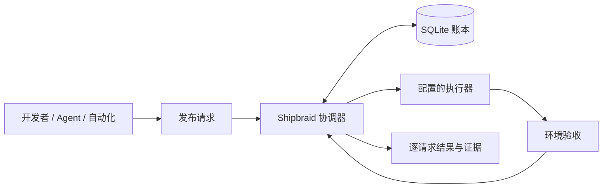

<p align="center">
  
</p>
<h1 align="center">Shipbraid</h1>
<p align="center"><strong>共享执行，安全接棒，验收交付。</strong></p>
<p align="center">使用 Rust 构建的持久化发布请求协调器。</p>
<p align="center"><a href="README.md">English</a> · 简体中文</p>

Shipbraid 协调开发者、Agent 和自动化提交的上线需求。兼容请求共享执行；紧急请求在安全条件下替代可打断的工作；每个请求独立保留，直到匹配的环境验收证据确认交付。

**当前状态：早期开发阶段。** 已实现本地模拟和可配置外部 hooks。安全抢占目前适用于模拟执行器，外部 hooks 整体不可抢占，生产通道默认禁用。

CLI 与服务端可执行文件统一为 `shipbraid`，环境变量使用 `SHIPBRAID_` 前缀，新安装使用 `shipbraid.service`。已有安装升级前请阅读[改名与升级说明](docs/naming.md)。


只读 Dashboard 展示发布请求、关联执行与环境验收回执。

## 为什么需要 Shipbraid？

多个调用者可能同时要求发布同一版本。新的紧急版本可能覆盖已排队的需求。某次 CI 被取消后，调用者仍然需要知道自己的改动是否真正上线。

Shipbraid 为每个调用者保存持久化请求，并将请求结果与实际执行分开管理：

- **共享工作。** 兼容请求等待同一个 run，各自保留截止时间、权限与最终结果。
- **安全交接。** 在执行器具备相应能力时，紧急请求可替代可打断的普通执行；只有确认旧执行停止后才转移所有权。
- **验收交付。** 只有匹配的发布证据才能将请求标记为 `satisfied`；取消记录或 CI 绿色不能代替环境验收。
- **持久恢复。** 命令与审计事件持久保存；重启后继续核对执行状态，未知执行保留通道所有权。

一次执行可以是 `superseded`，它承载的请求则继续等待后继。执行被替代不会丢掉原始上线需求。

## 工作方式



**Request** 是不可变的上线需求；**Run** 是一次执行尝试；**Lane** 是共享部署边界，同一时间最多一个活动执行；**Receipt** 记录实际观察到的版本、组件、配置与验收结果。

覆盖判断同时检查仓库、通道、组件、配置、权限和版本策略。默认要求版本完全一致；显式启用的 `descendant` 模式还会验证 Git 祖先关系。祖先关系只证明版本历史，不能证明功能没有被 revert。

Shipbraid 协调发布请求，具体构建与部署由各项目使用自己的工具。运行形态是单个服务、本地 SQLite 数据库、HTTP API、CLI，以及只读 Dashboard。

## 快速开始：使用二进制

从 [GitHub Releases](https://github.com/aak1247/shipbraid/releases) 下载已发布版本的 Linux x86_64 GNU 发行包和 `.sha256`，校验后解压。发行包包含 CLI、服务端、构建好的 Dashboard、适配器和安装器，运行无需 Rust 或 Node.js。首次公开发行需由维护者完成 tag 和 Release 发布；具体版本以 Releases 页面为准。

```bash
# 文件名以下载的版本为准；以下以 0.3.1 为例。
sha256sum --check shipbraid-0.3.1-x86_64-unknown-linux-gnu.tar.gz.sha256
tar -xzf shipbraid-0.3.1-x86_64-unknown-linux-gnu.tar.gz
cd shipbraid-0.3.1-x86_64-unknown-linux-gnu
export SHIPBRAID_BUNDLE="$PWD"
export PATH="$SHIPBRAID_BUNDLE/bin:$PATH"
shipbraid --version
```

第一次体验可直接按[本地模拟](docs/distribution.md#本地模拟)启动二进制和内置 Dashboard，不部署真实应用。需要发布自己的项目时，维护者先按[二进制安装与接入](docs/distribution.md#首次接入自己的项目)注册受信仓库、部署脚本和独立验收脚本。安装器和本机适配器需要 Python **3.11+**；本机任务由 systemd user manager 独立托管。安装本身不会启动服务或发布应用。

项目已接入时，开发者只需团队提供的服务地址、token 文件和通道配置：

```bash
export SHIPBRAID_URL="http://127.0.0.1:8787"
export SHIPBRAID_TOKEN_FILE="$HOME/.config/shipbraid/my-project.token"
shipbraid --json system
shipbraid --json list lane
shipbraid submit \
  --project my-project --environment dev \
  --revision <已同步的完整SHA> --components app \
  --idempotency-key <本次发布意图的稳定键>
shipbraid wait REQUEST_ID --timeout-seconds 600
shipbraid inspect request REQUEST_ID
```

示例目标、组件和凭据路径必须替换为项目实际值；`REQUEST_ID` 使用 submit 返回的 id。同一意图重试保持相同幂等键和正文，同键不同正文返回冲突。默认 exact；`descendant` 需要通道显式开启。

`wait` 超时或断开不会撤回服务端请求。退出码：`0` 已满足、`2` 需处理、`3` 过期、`4` 已撤回、`124` 本地超时、`1` 命令或配置错误。

Dashboard 由同一服务提供，默认打开 `http://127.0.0.1:8787`，输入自己的令牌即可；令牌只驻留页面内存。无需另启前端开发服务器。远程访问使用团队配置的受控 HTTPS 入口或 SSH 转发。

## Agent 使用

[Agent 使用指南](docs/agents.md)包含身份配置、目标发现、任务恢复、结构化 CLI 错误和协作权限。当前租户由服务端固定为 `local`。

## 接入执行器

外部集成使用管理员配置的 **command、script 或 webhook**，通过版本化 JSON 协议交接：

| 操作 | 职责 |
| --- | --- |
| `dispatch` | 交接任务，返回稳定执行身份。 |
| `observe` | 独立查询实际执行状态。 |
| `verify` | 观察目标环境，返回匹配的发布验收证据。 |

长任务由独立监督器运行。成功交接不等于发布验收成功。Hooks v1 要求 `allow_preemption = false`，不提供 cancel hook。

配置方式见[执行器协议](docs/hooks.md)和[项目接入指南](docs/project-integration.md)。Shipbraid 不依赖接入项目的数据库、运行时或业务实体。

## 运行模型与当前限制

- **单实例、本地存储。** SQLite 使用 WAL、FULL 同步与进程独占锁；使用本地持久卷，活动数据库通过 SQLite 在线备份 API 备份。
- **显式权限边界。** 仓库、通道、组件、执行器与令牌能力均由管理员配置。调用者不能提交任意命令或仓库 URL。默认监听 loopback，远程访问应使用受控 HTTPS 入口。
- **有证据才交接。** 取消响应、超时和心跳丢失都不能证明执行已经停止；unknown 会阻塞通道。部署与验收阶段不可抢占。
- **至少一次交付。** 命令与事件可能重复投递，适配器需要处理重复及不确定投递；不保证外部副作用恰好执行一次。

当前环境新鲜证据复用、可配置自动重试预算、公平策略、完整崩溃/故障矩阵和导出的阶段指标仍待补齐。已记录的 **50 请求/秒、持续 60 秒、p95 < 250ms** 性能目标**尚未通过**。实测结果和剩余工作见[验收记录](docs/acceptance/m1.md)与[执行计划](docs/execution-plan.md)。

## 开发与贡献

```bash
cargo fmt --all --check
cargo clippy --locked --all-targets -- -D warnings
cargo test --locked
cargo build --locked
python3 scripts/acceptance.py
python3 scripts/acceptance-hooks.py
python3 scripts/acceptance-agents.py
python3 scripts/test_package_release.py
python3 deploy/test_install_standalone.py
python3 integration/local/test_adapter.py
python3 integration/github/test_receiver.py

pnpm --dir web install --frozen-lockfile
pnpm --dir web typecheck
pnpm --dir web test
pnpm --dir web build
```

验收脚本使用临时仓库、数据库与令牌。Hook 协议夹具为合成场景，不会部署真实应用。

欢迎贡献。建议先阅读[设计文档](docs/design.md)、[执行计划](docs/execution-plan.md)和 [Agent 工作约束](AGENTS.md)。保持请求结果与执行状态分离，为新增能力提供验证证据。不要提交令牌、私钥、完整数据库或含秘密的部署日志。

## 文档

- [二进制安装、项目脚本、webhook 与升级](docs/distribution.md)
- [Agent 工作流与协作](docs/agents.md)
- [项目接入与项目 AGENTS.md 模板](docs/project-integration.md)
- [HTTP API 与 CLI 契约](docs/api.md)
- [外部执行器与安装](docs/hooks.md)
- [架构与领域模型](docs/design.md)
- [前后端实施契约](docs/implementation-contract.md)
- [验收结果与已知缺口](docs/acceptance/m1.md)
- [Logo 与品牌资产](docs/assets/README.md)

## 许可证

[MIT](LICENSE)。
